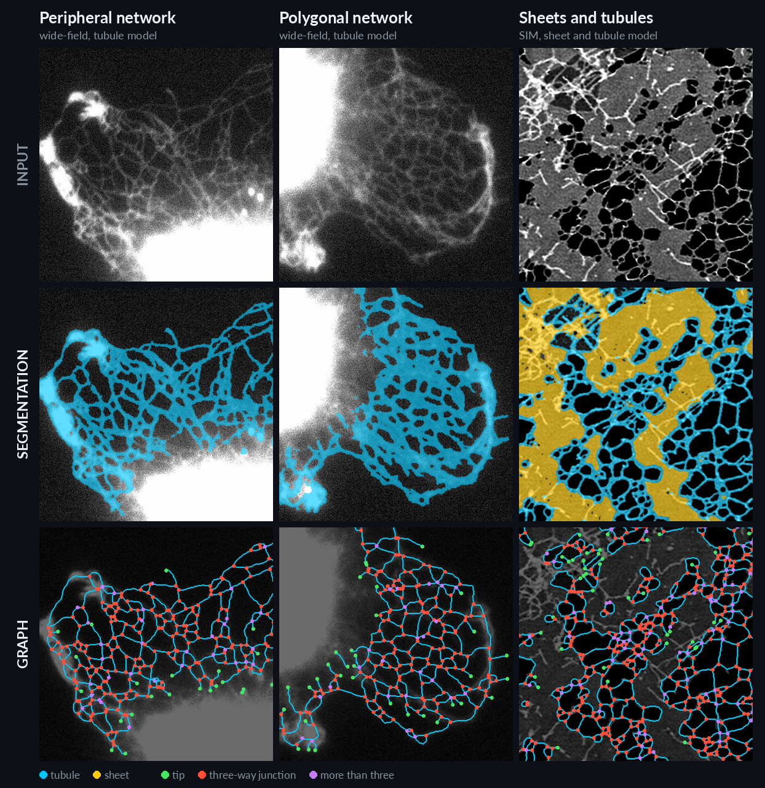
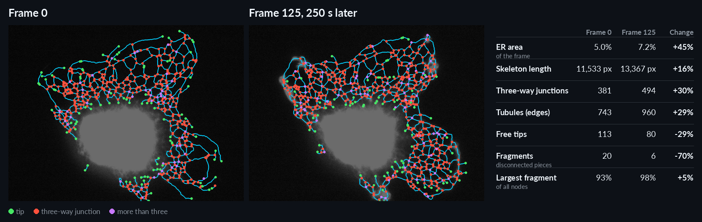
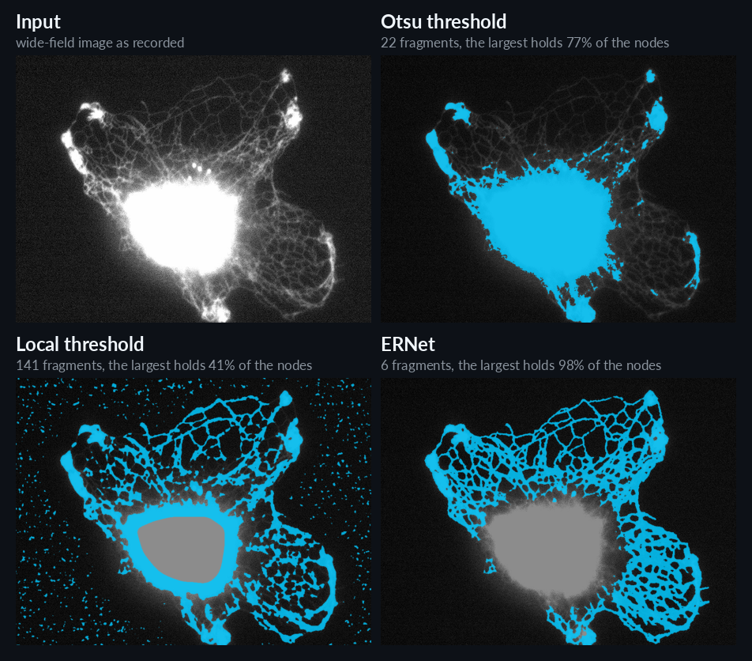
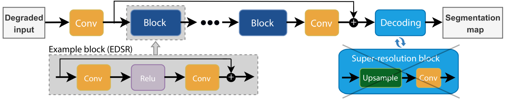

<h1 align="center">ERNet</h1>

<p align="center">
  <b>A super-resolution network, rebuilt to trace the endoplasmic reticulum.</b><br>
  It never downsamples, so tubules a few pixels wide come out in one piece.<br>
  This is the original CNN. The transformer that followed it is <a href="https://github.com/charlesnchr/ERnet-v2">ERnet-v2</a>.
</p>

<p align="center">
  <a href="https://doi.org/10.1126/sciadv.abc7209"></a>
  <a href="https://doi.org/10.1101/2020.01.15.907444"></a>
  <a href="https://github.com/charlesnchr/ERnet-v2"></a>
  <a href="LICENSE"></a>
</p>

<p align="center">
  
</p>
<p align="center">
  <sub>A live COS-7 cell under a wide-field microscope and a SIM image of the ER, segmented and converted to a graph by the two models in this repository. Run <code>python fig/make_figures.py</code> to reproduce it.</sub>
</p>

The endoplasmic reticulum (ER) is a web of membrane tubules that spans the cell and rewires itself within seconds. Under a wide-field microscope the tubules are faint lines a few pixels wide, next to a cell body bright enough to saturate the camera. An intensity threshold cannot separate the two. Set it for the cell body and the network disappears. Set it for the tubules and the network comes out in pieces.

ERNet starts from a network that was never meant for segmentation. [RCAN](https://arxiv.org/abs/1807.02758) was designed for single-image super-resolution, and every one of its layers works at the full resolution of the input. We cut off its upsampling stage and put a per-pixel classifier in its place. The layers that would restore a noisy image now restore and label it in one pass, and no tubule is lost to downsampling along the way.

We built it for [Lu et al., Science Advances 2020](https://doi.org/10.1126/sciadv.abc7209), the study that showed lysosomes pulling ER tubules along and reshaping the network. It later grew into [ERnet](https://github.com/charlesnchr/ERnet-v2), published in Nature Methods in 2023. This repository is where that line of work began, and its models still run with one command.

- **Full resolution from input to output.** No layer shrinks the image. Residual blocks with channel attention work on it at its native size, and a 1x1 convolution turns the last feature map into a class score for every pixel.
- **Keeps the network in one piece.** On the test cell, ERNet returns a tubule network in 6 fragments, and the largest holds 98% of the nodes. We tried 32 settings of a local threshold on the same frame. None left fewer than 58 fragments, and none kept more than 41% of the nodes together.
- **Trained on five labelled images.** The tubule model learned from five hand-cleaned label maps cut into 500 crops. The labels and the crops are in the repository.
- **From pixels to a graph.** `segment.py` thins the tubules to a skeleton and counts tips, three-way junctions, tubules and disconnected fragments in every frame.
- **Two models.** One separates tubules from background in wide-field images. The other separates sheets from tubules in SIM images, and it is the model behind the ERnet plugin of the [ML-SIM](https://github.com/charlesnchr/ML-SIM) desktop app.
- **No GPU needed.** A 1392x1040 frame takes about 75 s on four CPU cores.
- **Published and built upon.** The Science Advances paper has been cited more than 100 times, and the method continued as ERnet in [Nature Methods](https://doi.org/10.1038/s41592-023-01815-0).

## Try it

```bash
git clone https://github.com/charlesnchr/ERNet && cd ERNet
pip install -r requirements.txt
python segment.py testdata/input/*.png
```

This segments the two wide-field test images with the tubule model. The weights come with the repository, which makes the clone about 140 MB. A GPU is used when one is available.

On a machine without a GPU, install the CPU build of PyTorch first. It is a much smaller download than the default build.

```bash
pip install torch torchvision --index-url https://download.pytorch.org/whl/cpu
```

Everything lands in `segmented/`.

| File | Contents |
| --- | --- |
| `NAME_classes.png` | The class of every pixel as a grey value: 0 background, 127 sheet, 255 tubule |
| `NAME_overlay.png` | The classes in colour over the input, tubules cyan and sheets yellow |
| `NAME_graph.png` | The skeleton of the tubules over the input, with tips in green, three-way junctions in red and junctions of more than three tubules in violet |
| `metrics.csv` | One row per frame with the ER area and the graph measurements. Rows from earlier runs are kept |

The second model separates sheets from tubules in super-resolution images. The script downloads it (19 MB) on first use and checks its hash.

```bash
python segment.py --model sheets testdata/input_sim/*.png
```

To run either model on your own data, pass greyscale PNG, JPG or TIFF files. A multi-frame TIFF is treated as a time-lapse, and every frame gets its own outputs and its own row in `metrics.csv`.

The two models expect different input. The tubule model was trained on 8-bit wide-field images and uses them as stored, so export yours with contrast like the test images, where the tubules are clearly visible and the cell body saturates. Frames with more than 8 bits are scaled to their 99.9th percentile. The sheet model stretches every frame between its 1st and 99th percentile. `--stretch LOW HIGH` sets the percentiles by hand for either model.

## Results

Each column is a 360 px crop of a test image, with the output of `segment.py`. The two wide-field crops show the tubule model. The SIM crop shows the sheet and tubule model, where only the tubules go into the graph.

<p align="center">
  
</p>

### One cell, 250 seconds apart

The file names of the two wide-field test images match the optogenetic experiment in the paper, a COS-7 cell with the ER labelled in YFP and imaged every 2 s. In that experiment blue light sends the lysosomes to the edge of the cell, and the paper reports a burst of ER tubule growth where they arrive. By their numbering the test images are frames 0 and 125 of one recording, so they show the same cell 250 s apart.

<p align="center">
  
</p>

ERNet puts numbers on what happened in between. The lobe on the lower right goes from a few long loops to a dense polygonal mesh. Across the cell the ER covers 45% more area, the count of three-way junctions rises from 381 to 494, and the network closes up from 20 fragments to 6.

This is one cell and two frames, measured with the code in this repository. It shows what the output is for. The paper's own analysis of the experiment covers eight cells.

### Against intensity thresholds

The obvious alternative is a threshold. The figure applies an Otsu threshold and a local threshold to frame 125, and runs the graph extraction of `segment.py` on each mask.

<p align="center">
  
</p>

The Otsu threshold finds the cell body and little else. The local threshold finds the tubules but cuts them wherever the signal dips, picks up noise in the background and draws a ring around the cell body. The setting shown is the best connected of the 32 we tried, with two smoothing widths, four window sizes and four offsets. `python fig/make_figures.py --sweep` prints all of them.

## How it works

<p align="center">
  
</p>

**1. A restoration network without the upsampling.** A first convolution lifts the greyscale input to 64 feature channels. Residual groups follow. Each group is a stack of 10 blocks, and each block is two 3x3 convolutions and a channel attention gate. Skip connections run around every block, every group and the whole body, so the low-frequency content of the image passes straight through and the layers can spend their capacity on fine detail. The tubule model has five groups and 3.9 million parameters. The sheet model has two groups and 1.6 million.

**2. A classifier in place of the super-resolution block.** [EDSR](https://arxiv.org/abs/1707.02921) and [RCAN](https://arxiv.org/abs/1807.02758) end in a block that upsamples the feature maps. ERNet ends in a 1x1 convolution that reduces the 64 channels to one score per class. Training minimises the cross-entropy between those scores and the label map, and at inference every pixel gets the class with the highest score. The network could have been trained to restore the image, with a threshold applied to its output afterwards. The paper prefers direct classification, because a squared error loss saturates and learns slowly on outputs of this kind.

**3. Labels from a handful of images.** The label maps for the tubule model started as a rough threshold of a frame denoised with ND-SAFIR, and were then cleaned up by hand in an image editor. Five of them are in `trainingdata/labelled_data`. `buildTrainingData.py` cuts 100 random 256 px crops from each, changes their brightness and adds either noise or blur. The data loader flips and transposes them at random during training.

**4. Skeleton and graph.** `segment.py` takes the tubule pixels, drops specks smaller than 50 px and thins the rest to lines one pixel wide. Branches shorter than 6 px that end in a tip are pruned, because thinning leaves such spurs on thick structures. Skeleton pixels with one neighbour become tips, pixels with more than two become junctions, and the lines between them become the edges of a [NetworkX](https://networkx.org/) graph.

`metrics.csv` has these columns.

| Column | Meaning |
| --- | --- |
| `er_fraction` | Share of the frame covered by ER |
| `tubule_fraction`, `sheet_fraction` | Share of each class in the ER area |
| `skeleton_length_px` | Total length of the tubule skeleton in pixels |
| `nodes`, `edges` | Size of the tubule graph |
| `tips` | Nodes with one tubule attached, the free ends |
| `three_way_junctions`, `multiway_junctions` | Nodes where three tubules meet, and nodes where more than three meet |
| `fragments` | Number of disconnected pieces of the graph |
| `largest_fragment_share` | Share of the nodes that belong to the largest fragment. 1 is a fully connected network |
| `assortativity` | Whether nodes connect to nodes of similar degree, from -1 to 1 |
| `clustering` | Average clustering coefficient of the graph |

## Train a model on your own images

The tubule model has seen five wide-field images that look like the test images. For data that looks different, label a few images and train your own. Five label maps were enough for the released model.

The image is a greyscale file. Its label is an RGBA PNG of the same size, opaque where there is ER and transparent elsewhere. List your image and label pairs in `allimgs` at the bottom of `buildTrainingData.py`, then cut them into crops.

```bash
python buildTrainingData.py
```

This writes 100 crops per image to `trainingdata/testpartitioned_256`. The copy in `trainingdata/partitioned_256` is the set the released model was trained on. Train on either folder with `run.py`.

```bash
python run.py --root trainingdata/partitioned_256 --out trained_models/ERNet_rcan-rg5 \
    --dataset pickledataset --imageSize 256 --ntrain 480 --ntest 20 --batchSize 2 \
    --model rcan --nch_in 1 --nch_out 2 --n_resgroups 5 --n_resblocks 10 \
    --lr 0.0001 --scheduler 20,0.5 --nepoch 100
```

After every epoch the script writes validation images to the output folder, with the input, the prediction and the label side by side. The finished model works with `segment.py`.

```bash
python segment.py --weights trained_models/ERNet_rcan-rg5/final.pth your_image.png
```

Add `--cpu` to try the training without a GPU. It runs, but at about 5 s per crop on four cores a full run needs a GPU. `python run.py -h` lists every option, including `--model edsr` and `--model unet` for the other architectures in `models.py`. `evaluate.py` segments images with any of them, and `run.ipynb` walks through the training in a notebook.

## What is in the repository

| Path | Contents |
| --- | --- |
| `segment.py` | Segment images and stacks with the pre-trained models and measure the tubule graph |
| `pretrained_model/` | The tubule model and a training log with its options |
| `run.py`, `models.py`, `datahandler.py`, `plotting.py`, `options.py` | Training loop, network architectures, data loading, validation plots and command line options |
| `evaluate.py` | The original evaluation script, for models with any of the architectures |
| `buildTrainingData.py` | Cuts labelled images into augmented training crops |
| `trainingdata/` | Five labelled images and the 500 crops made from them |
| `testdata/` | Two wide-field test images with the masks from `evaluate.py`, and one SIM test image |
| `fig/make_figures.py` | Regenerates the figures on this page |

Both models are also on the [v1.0 release](https://github.com/charlesnchr/ERNet/releases/tag/v1.0) as direct downloads.

## Limits

- This is the first version. [ERnet-v2](https://github.com/charlesnchr/ERnet-v2) has a transformer model with four classes, was tested on more microscopes and cell types, and was checked against ground truth. Use it for new work unless you need a plain CNN or a model trained on wide-field images like the test images.
- The tubule model was trained on five wide-field images that look like the test images. Expect to retrain it for other optics or cell types.
- Neither model here has a published accuracy figure. The fragment counts above compare ERNet with thresholds on one frame, and they are not a benchmark against labelled ground truth.
- The saturated region around the nucleus is left unlabelled. Wide-field imaging cannot resolve the ER there.
- The channel attention pools over the whole tile, so the result depends slightly on how a frame is tiled. For the test images, one pass and the four overlapping tiles of `evaluate.py` disagree on fewer than 0.1% of the pixels.
- The graph comes from a 2D image. Tubules that cross at different heights appear as a junction, and the number of tips is sensitive to noise at the edge of the mask.

## Citation

```bibtex
@article{lu2020lysosomes,
  title   = {The structure and global distribution of the endoplasmic reticulum network are actively regulated by lysosomes},
  author  = {Lu, Meng and van Tartwijk, Francesca W. and Lin, Julie Qiaojin and Nijenhuis, Wilco and Parutto, Pierre and Fantham, Marcus and Christensen, Charles N. and Avezov, Edward and Holt, Christine E. and Tunnacliffe, Alan and Holcman, David and Kapitein, Lukas and Kaminski Schierle, Gabriele S. and Kaminski, Clemens F.},
  journal = {Science Advances},
  volume  = {6},
  number  = {51},
  pages   = {eabc7209},
  year    = {2020},
  doi     = {10.1126/sciadv.abc7209}
}
```

The segmentation network is described in the Methods section of the paper, under "Segmentation using deep convolutional neural networks". If you use the later transformer model, cite the [Nature Methods paper](https://doi.org/10.1038/s41592-023-01815-0) of ERnet-v2.

ERNet was written by Charles N. Christensen in the [Laser Analytics Group](https://laser.ceb.cam.ac.uk/) at the University of Cambridge, for a study led by Meng Lu and Clemens F. Kaminski. Questions about the code go to Charles, through the [issue tracker](https://github.com/charlesnchr/ERNet/issues) or at `charles.n.chr@gmail.com`.

## Related work

- [ERnet-v2](https://github.com/charlesnchr/ERnet-v2) is the successor, a vision transformer that labels tubules, sheets and sheet-based tubules and analyses the topology of the network.
- [ML-SIM](https://github.com/charlesnchr/ML-SIM) reconstructs the super-resolution SIM images that the sheet model works on, and its desktop app includes that model as a plugin.
- [VSR-SIM](https://github.com/charlesnchr/VSR-SIM) reconstructs SIM videos of moving samples with a transformer.

## License

The code and the pre-trained weights are released under the [GNU General Public License v3.0](LICENSE). You can use, modify and redistribute them, and derived work that you distribute has to stay under the same license. [`THIRD_PARTY_NOTICES`](THIRD_PARTY_NOTICES) lists the code that comes from other projects.

## Credits

- [EDSR-PyTorch](https://github.com/sanghyun-son/EDSR-PyTorch) and [RCAN](https://github.com/yulunzhang/RCAN) for the network architectures.
- [Pytorch-UNet](https://github.com/milesial/Pytorch-UNet) for the U-Net in `models.py`.
