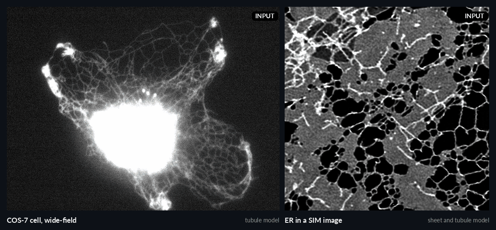
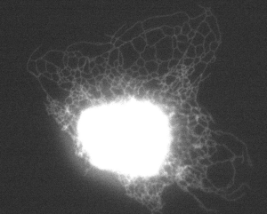
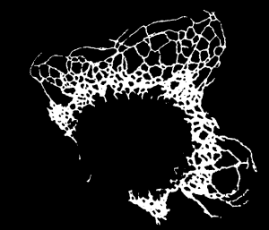

<h1 align="center">ERNet</h1>

<p align="center">
  <b>A super-resolution network, rebuilt to trace the endoplasmic reticulum.</b><br>
  It never downsamples, so tubules a few pixels wide come out in one piece.<br>
  This is the original CNN. The transformer that followed it is <a href="https://github.com/charlesnchr/ERnet-v2">ERnet-v2</a>.
</p>

<p align="center">
  <a href="https://doi.org/10.1126/sciadv.abc7209"></a>
  <a href="https://doi.org/10.1101/2020.01.15.907444"></a>
  <a href="https://github.com/charlesnchr/ERnet-v2"></a>
  <a href="LICENSE"></a>
</p>

<p align="center">
  
</p>
<p align="center">
  <sub>A live COS-7 cell under a wide-field microscope and a SIM image of the ER, segmented and converted to a graph by the two models in this repository. Run <code>python fig/make_figures.py</code> to reproduce it.</sub>
</p>

The endoplasmic reticulum (ER) is a web of membrane tubules that spans the cell and rewires itself within seconds. Under a wide-field microscope the tubules are faint lines a few pixels wide, next to a cell body bright enough to saturate the camera. An intensity threshold cannot separate the two. Set it for the cell body and the network disappears. Set it for the tubules and the network comes out in pieces.

ERNet starts from a network that was never meant for segmentation. [RCAN](https://arxiv.org/abs/1807.02758) was designed for single-image super-resolution, and every one of its layers works at the full resolution of the input. We cut off its upsampling stage and put a per-pixel classifier in its place. The layers that would restore a noisy image now restore and label it in one pass, and no tubule is lost to downsampling along the way.

We built it for [Lu et al., Science Advances 2020](https://doi.org/10.1126/sciadv.abc7209), the study that showed lysosomes pulling ER tubules along and reshaping the network. It later grew into [ERnet](https://github.com/charlesnchr/ERnet-v2), published in Nature Methods in 2023. This repository is where that line of work began, and its models still run with one command.

- **Full resolution from input to output.** No layer shrinks the image. Residual blocks with channel attention work on it at its native size, and a 1x1 convolution turns the last feature map into a class score for every pixel.
- **Keeps the network in one piece.** On the test cell, ERNet returns a tubule network in 6 fragments, and the largest holds 98% of the nodes. We tried 32 settings of a local threshold on the same frame. None left fewer than 58 fragments, and none kept more than 41% of the nodes together.
- **Trained on five labelled images.** The tubule model learned from five hand-cleaned label maps cut into 500 crops. The labels and the crops are in the repository.
- **From pixels to a graph.** `segment.py` thins the tubules to a skeleton and counts tips, three-way junctions, tubules and disconnected fragments in every frame.
- **Two models.** One separates tubules from background in wide-field images. The other separates sheets from tubules in SIM images, and it is the model behind the ERnet plugin of the [ML-SIM](https://github.com/charlesnchr/ML-SIM) desktop app.
- **No GPU needed.** A 1392x1040 frame takes about 75 s on four CPU cores.
- **Published and built upon.** The Science Advances paper has been cited more than 100 times, and the method continued as ERnet in [Nature Methods](https://doi.org/10.1038/s41592-023-01815-0).

## Introduction

ERNet is an artificial neural network based model for segmentation of endoplasmic reticulum microscopy images. The network architecture of choice is a deep residual network inspired by EDSR and RCAN ([Lim et al. 2017](https://arxiv.org/abs/1707.02921), [Zhang et al., 2018](https://arxiv.org/abs/1807.02758)). The modified architecture is shown in the image below with a block corresponding to EDSR.


The architectures of these models are among several residual learning networks (cite ResNet, SRGan, EDSR) designed for image restoration, specifically single image super-resolution (SR), i.e. image upsampling. The state-of-the-art SR architectures generally do not use downsampling between layers, but instead make training of deep networks feasible by following the structure of residual networks as first introduced with ResNets intended for image classification. The design idea of residual networks was taken one step further in EDSR with the proposal of a modified residual building block called ResBlock, which was found to be superior to the previously proposed and more directly adapted ResNet model called SRResNet

Choosing the first part of our segmentation model to have an architecture built for restoration ensures that it is capable of handling low signal-to-noise ratio as it can learn to perform denoising in these early layers of its network. A neural network model intended for image restoration will by default perform regression in order to output pixel value predictions in the same colour space as the input image. This is achieved during model training by minimising an appropriate loss function, typically the mean squared error.

## Installation :wrench:

This implementation requires Pytorch. We have tested ERNet with Python 3.6 and 3.7 and Pytorch 1.2 and 1.4.

## Training data :bar_chart:
A simple training data set is provided in `./trainingdata/partitioned_256`. This dataset is preprocessed based on the labelled datafiles in `./trainingdata/labelled_data` using the command:
```powershell
python buildTrainingData.py
```

## Model training :watch:


* Start in the root folder: ```./```
* See available command line options with `python run.py -h`
* An example of options for training with RCAN could be:
  ```powershell
  --root trainingdata/partitioned_256
  --out trained_models/ERNet_rcan-rg5
  --imageSize 256
  --model rcan
  --nch_in 1
  --nch_out 2
  --ntrain 480
  --ntest 20
  --batchSize 2
  --n_resgroups 5
  --n_resblocks 10
  --lr 0.0001
  --scheduler 20,0.5
  --nepoch 100
  --dataset pickledataset
  ```
* Run the `run.py` script with Python, e.g.:
  ```powershell
  python run.py --root trainingdata/partitioned_256 --out trained_models/ERNet_rcan-rg5 --imageSize 256 --model rcan --nch_in 1 --nch_out 2 --ntrain 480 --ntest 20 --batchSize 2 --n_resgroups 5 --n_resblocks 10 --lr 0.0001 --scheduler 20,0.5 --nepoch 100 --dataset pickledataset
  ```

## Testing
A couple of test images of the endoplasmic reticulum are provided in `testdata/input`, for instance:



To evaluate a model on these images in order to get the segmentation maps, use the script `evaluate.py`.

 A simple pretrained model based on the example in the 'Model training' section is in the folder `pretrained_model`.

__Evaluating inputs with a model:__
* Start in the root folder: ```./```
* See available command line options with `python evaluate.py -h`
* An example of applying the pretrained model on the provided test images could be:
  ```powershell
  --root testdata/input
  --weights pretrained_model
  --imageSize 1000
  --out testdata/output
  --model rcan
  --nch_in 1
  --nch_out 2
  --n_resgroups 5
  --n_resblocks 10
  ```
* Run the `evaluate.py` script with Python, e.g.:
  ```powershell
  python evaluate.py --root testdata/input --weights pretrained_model --imageSize 1000 --out testdata/output --model rcan --nch_in 1 --nch_out 2 --n_resgroups 5 --n_resblocks 10
  ```

The above example generates the output in `testdata/output`, such as:

 
